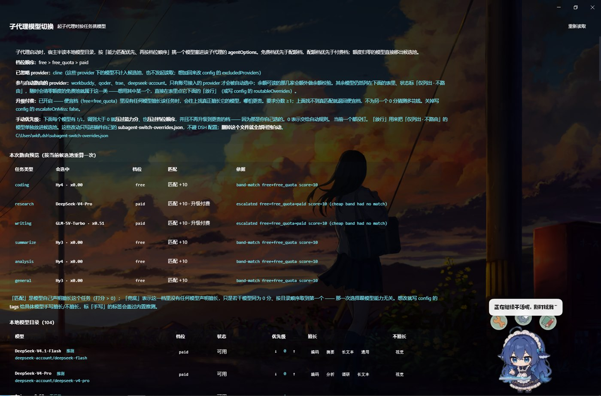

# dsh-subagent-switch

**给 DeepSeek Harness（DSH）的子代理自动挑模型的插件。** 每次 spawn 子代理时，它会先看一眼你本机所有接入的模型，然后按「便宜优先 + 能力匹配 + 额度够不够」替这次任务选一个，再把结果写进子代理的会话配置里。默认只花订阅里已经付过的钱；便宜档确实没人擅长这件事时，才允许升到付费档。



> 上面是这台机器上的真实截图（104 个模型接入）。从上往下：
> **顶部几行**是这次判断的依据 —— 档位顺序、被忽略的 provider、参与自动路由的 provider、升级付费开没开、手动优先级钉了几个。
> **「本次路由预览」**把六类任务当前会选到谁、为什么选它一次列全：`coding` 落在免费档的 `Hy4 · x0.00`（`band-match score=10`）；`research` 和 `writing` 在便宜档里没人真正擅长，于是往上找到真匹配的 `DeepSeek-V4-Pro`、`GLM-5V-Turbo · x0.51`，标「升级付费」，依据写明是 `escalated ... (cheap band had no match)`。
> **「本地模型目录」**是完整候选池，每行有档位、状态（可用 / 仅列出·不路由 / 额度用尽）、优先级 ↑↓、以及标了「推测」或「手写」来源的擅长/不擅长。
>
> 这张图想说明的就一件事：**它的每次选择都带理由**，不是黑箱。

> Subagents in DSH normally inherit whatever model the parent session is on. If you have 100+ models across several providers, that means your research subagent is burning `x1.62` tokens to answer a one-line question — or your coding subagent is running on the free model that's explicitly bad at code. This plugin intercepts the spawn and picks per task instead.

如果你觉得它有用，**给个 Star** ⭐ —— 这类小工具没什么曝光，一颗星就是最直接的反馈，也让后面需要它的人更容易搜到。

---

## 它解决什么问题

一台接了几个账号 provider 的 DSH 机器，模型目录长这样（真实数据，107 个）：

| provider | 模型数 | 能读余额 | 说明 |
|---|---|---|---|
| `workbuddy` | 20 | ✅ | 显示名里带价格倍率，如 `Hy3 · x0.00`、`DeepSeek-V4.1-Flash · x0.11` |
| `trae` | 35 | ❌ | 账号订阅，有余额接口但拿不到 |
| `our-free-model` | 33 | ❌ | 无账号、无登录态，额度随时清零 |
| `qoder` | 17 | ✅ | |
| `deepseek-account` | 2 | ❌ | |
| `cline` | 459 | — | **默认整块排除**，见下文 |

面对这样一堆模型，手动选是选不过来的：你不知道哪个擅长什么，不知道哪个快没额度了，也懒得为每个子代理点一次。这插件干的就是这件事 —— 而且**每次选择都告诉你理由**（`matched` / `score` / `tier` / `reason`），不是黑箱。

---

## 功能

- **按能力挑模型，不只看价格。** 每个模型带 `goodAt` / `badAt`，每个任务归到 `coding` / `research` / `writing` / `summarize` / `analysis` 等域，命中打分（required 域 +10、optional +2、不擅长 −10/−2）。
- **免费优先，但不是免费的都先选。** `free` 和 `free_quota` 合成一个档带按能力分一起排 —— 一个明确标了「不擅长编码」的免费模型，不会赢过一个 `x0.08` 真擅长编码的模型。两档都是订阅里已付的钱，价差四舍五入为零。
- **条件升级付费。** 只有便宜档里**没有任何模型真正声明擅长**这个域时，才往付费档升 —— 且只升到「真匹配」的模型，**绝不为另一个 0 分猜测花 4~8 倍的钱**。升级是可见的：面板标「升级付费」，日志写明被跳过了什么、它几分。
- **路由门禁：只让账号接入的模型进子代理。** 这类模型才有可能读到余额、才有可能稳定存在。`our-free-model` 那种随时清零的仍然列在面板里，但不参与自动选择（可以手动「放行」）。
- **能力标签来源分三层，且标出可信度。** 手写 config > 内置系列预设 > 无标签。面板上分别标「手写 / 推测 / 无标签」—— **猜出来的标签和手写的看起来一样权威**，不标出来，由它们驱动的路由就没法审计。
- **中英文标签都认。** `"goodAt": ["编码"]` 和 `["coding"]` 等价，内部统一翻成英文 canonical id（下游比的是字符串相等，存中文会静默失效）。
- **手动优先级压过一切。** 面板里 ↑/↓ 调到 >0，就压过能力分、压过档位顺序、并且不再升级付费。想让某个模型只用它，就钉住它。
- **一个独立面板**（不改动原模型选择栏）：模型表、六类任务的路由预览、优先级、放行/收回、黑名单。
- **额度真读。** 直接打 provider 插件自己的 HTTP 端点拿余额，余额写回该 provider 下每个模型，读到 0 整体退出选择。
- **零依赖、零联网。** 纯 Node 内置模块；不装任何包，不发任何外部请求（除了读本机 provider 的额度端点）。
- **143 个单测**，纯 `node:test`。

---

## 安装

### 从 GitHub 装（推荐给使用者）

```bash
cd <你的 profile 目录>          # 官方 profile 一般在 ~/.dsh/profiles/desktop
pnpm add "git+https://github.com/wld12314/dsh-subagent-switch#v0.1.1"
```

然后在 `<profile>/cordis.patch.yml` 里插一行：

```yaml
- insert:
    - id: '@local/subagent-switch'
      name: '@local/subagent-switch'
```

重启 DSH，左侧栏出现「子代理模型切换」。

> 用 tag 而不是 `main`，是为了你装到的版本不会随我后续提交变化。想跟最新就换成 `#main`。

### 或者走插件市场

把 [market-index.json](https://raw.githubusercontent.com/wld12314/dsh-subagent-switch/main/market-index.json) 加进 Discover 的索引源，搜「子代理」「模型路由」「quota」都能命中，然后点安装。界面上怎么加见下面「[怎么给插件市场扫到](#怎么给插件市场扫到)」。

### 从源码开发（`link:` 方式）

插件走 DSH 的标准 profile 机制（和官方插件一样），三处改动，都可逆。

#### 1. 放进 profile

```bash
# 假设插件源码在 <插件目录>，profile 在 <profile 目录>
# 官方 profile 一般在 ~/.dsh/profiles/desktop
```

编辑 `<profile>/package.json`：

```jsonc
{
  "dependencies": {
    "@local/subagent-switch": "link:<插件目录>"
  },
  "dsh": {
    "profile": {
      "bundles": [
        "@local/subagent-switch"   // 加这一行
      ]
    }
  }
}
```

#### 2. 建软链接

```bash
# Linux / macOS
ln -s <插件目录> <profile>/node_modules/@local/subagent-switch

# Windows（Git Bash 里同样可用上面的命令；PowerShell 用 junction）
New-Item -ItemType Junction `
  -Path "<profile>\node_modules\@local\subagent-switch" `
  -Target "<插件目录>"
```

#### 3. 重启 DSH

bundle 只在启动时加载。重启后左侧栏会多一个「子代理模型切换」入口。

> **改了插件代码也要重启。** 宿主半（`lib/*.js`）是启动时 import 的；浏览器半（`lib/ui/client.js`）在页面刷新时重新加载。

---

## 装上之后

左侧栏多了「子代理模型切换」入口，点进去就是上面开头那张图里的面板。**不需要改任何配置**：默认就是免费优先 + 能力匹配 + 门禁，装上即用。

## 怎么给插件市场扫到

本插件自带一个 **[format-1 市场索引](market-index.json)**，里面写了标题、分类、标签、关键词（中英双语 40 个）、版本、git 源和 commit。DSH 的「发现」页就是读这种索引文件的。

两条路把它加进去：

**A. 在界面里加（推荐）**

1. 左侧栏 → **插件** → **实验性插件** 旁的 **更多** → 启用 **自定义插件市场**
2. 回到插件页，切到 **发现** 标签
3. 在索引源里填：

```
https://raw.githubusercontent.com/wld12314/dsh-subagent-switch/main/market-index.json
```

4. 搜「子代理」「模型路由」「quota」「routing」都能命中，然后点安装

**B. 直接写进 profile**

`<profile>/cordis.patch.yml` 里给 `plugin-market` 那行加 `indexes`：

```yaml
- id: plugin-market
  name: '@deepseek-ai/dsh-plugin-market'
  config:
    indexes:
      - https://raw.githubusercontent.com/wld12314/dsh-subagent-switch/main/market-index.json
```

> ⚠️ **索引不会自动被扫描到。** DSH 的插件市场**没有中央注册表**，`indexes` 默认是空数组，不会主动去 GitHub 上找插件 —— 只读你加进去的那几个 URL。所以「上架」这件事在这个生态里就等于「产出一个索引文件 + 把它的地址告诉用户」，没有别的一步。

本地已经装过（`link:` 装机）的话不用走这条路，那只是给**别人**用的分发方式。

## 怎么用

打开面板，从上到下：

1. **顶部说明区** —— 当前档位顺序、已忽略的 provider、参与自动路由的 provider、升级付费是否开启、手动优先级钉住了几个、overrides 文件在哪。
2. **本次路由预览** —— 六类任务（编码/调研/写作/摘要/分析/通用）现在会选中谁、什么档位、匹配还是兜底。**这是最有信息量的一栏**：`兜底 0 分 · 8 个并列` 就是在明说「这次不是能力匹配，是按目录顺序撞的」。
3. **模型表** —— 每个模型的档位、状态、擅长、不擅长、优先级。状态列的「放行」能让被门禁挡掉的模型重新参与。
4. **任务类型指定** —— 想给某类任务钉死一个模型，走 `routingTable`。

---

## 路由怎么决定（按顺序）

1. **`routingTable` 指定** —— 你给这个类别钉了模型就用它（不经过打分，`matched: null`）。
2. **全局 pin** —— 有优先级 >0 的模型，按优先级 → 能力分排，直接返回（`reason` 里写 `pinned, band order bypassed`）。
3. **档带内排序** —— `free`+`free_quota` 合成一层，按「优先级 → 能力分」排。
4. **命中就返回** —— 这一层有模型真声明擅长（`matched: true`），或者有 pin，就定了。
5. **条件升级** —— 这一层没人擅长，且 `escalateOnMiss` 开着，就往上找 `matched: true && score >= escalateMinScore` 的模型。找不到就留着便宜档那个。
6. **兜底** —— `defaultModel` → 任意可用模型。

`select()` 的返回体把每一步都摊开：

```jsonc
{
  "reason": "band-match free+free_quota score=10",
  "tier": "free_quota",
  "band": ["free", "free_quota"],
  "score": 10,
  "matched": true,        // false = 兜底；null = routingTable 指定
  "candidates": 15,
  "priority": 0,
  "pinned": false,
  "escalated": false,
  "skipped": null,
  "model": { "id": "workbuddy/deepseek-v4.1-flash", "name": "DeepSeek-V4.1-Flash · x0.11", "tagSource": "preset" }
}
```

### 实测（真实 107 个模型）

| 任务 | 选中 | 档位 | 匹配 |
|---|---|---|---|
| 编码 | `Qwen3.7-Plus · x0.1` | free_quota | +10 真匹配 |
| 调研 | `DeepSeek-V4-Pro` | **paid（升级）** | +10 —— 便宜档 research 擅长 0 / 不擅长 10 |
| 写作 | `MiniMax-M3 · x0.2` | **paid（升级）** | +10 —— 便宜档 writing 全中性 |
| 摘要 | `Hy3 · x0.00` | free | +10 |
| 分析 | `Qwen3.7-Plus · x0.1` | free_quota | +10 |
| 通用 | `Hy3 · x0.00` | free | +10 |

即**只有真没法在便宜档解决的两类任务才花钱**，其余一分不多花。

---

## 配置

配置有两个入口，都认：

- `<profile>/cordis.patch.yml` 里给本插件那行写 `config:`（**扁平**键值）
- 或改插件的 `config.example.json`（**嵌套**在 `"subagent-switch"` 下）

两种形状都会被剥壳合并，最终交给路由器的永远是扁平对象。**数组是替换不是追加** —— 写 `[]` 就是清空，想收窄不会被撑宽。

### 关键项

| 键 | 默认 | 说明 |
|---|---|---|
| `enabled` | `true` | 总开关 |
| `modelTiers` | `["free","free_quota","paid"]` | 分层顺序 |
| `cheapBand` | `["free","free_quota"]` | 合并成一个档带按能力排；`[]` 退回逐档走 |
| `escalateOnMiss` | `true` | 便宜档无匹配时是否允许升付费档 |
| `escalateMinScore` | `1` | 升级要求的最低分（10 = 只认 required 域强匹配） |
| `pricing` | `{freeMultiplierMax:0, quotaMultiplierMax:0.15}` | 价格倍率 → 档位阈值 |
| `tierMap` | `{}` | 把某个模型 id 显式钉到某档（最高优先级） |
| `tags` | `{}` | 手写能力标签，键支持 `provider/model` / 裸 id / 显示名 |
| `blacklist` | `[]` | 移出候选池 |
| `excludedProviders` | 内置 `["cline"]` | **整 provider 排除**，在发起 adapter 请求之前就跳过 |
| `requireQuotaAware` | `true` | 路由门禁总开关 |
| `routableOverrides` | `[]` | 门禁的逐模型例外 |
| `autoRouteSubagents` | `true` | 是否拦截 `startActivation` 自动改模型 |
| `forceOverride` | `false` | 为 `true` 时连调用方显式指定的模型也改写 |
| `overridesPath` | `""` | 手动优先级文件位置，空 = `~/.dsh/subagent-switch-overrides.json` |

### 手动优先级文件

```json
{
  "priority": { "workbuddy/glm-5.3": 2 },
  "routable": { "our-free-model/big-pickle": true }
}
```

- 原子写（tmp + rename），写失败不影响运行时，只是重启后会丢（面板红字提示）。
- **只用正向声明**：`0` 和 `false` 都删键，文件里只看得到你真正做过的决定。
- **删掉这个文件就全部回到自动。** 插件绝不碰 DSH profile 的 `cordis.patch.yml`。

---

## HTTP 接口

宿主半在 `webServer` 上注册一个前缀路由 `/subagent-switch-api`，面板就靠它取数据（这也是本机构建上验证过的方式，不需要 RPC）：

| 方法 | 路径 | 作用 |
|---|---|---|
| GET | `/state` | 标题、档位顺序、门禁名单、配额、优先级表、overrides 路径 |
| GET | `/models` | 全部模型 + 档位/状态/标签/优先级/可否路由/额度 |
| GET | `/routes` | 六类任务各会选中谁（含 `matched` / `score` / `escalated`） |
| GET | `/select?category=&description=` | 单次选择 |
| POST | `/priority` `{id, priority}` | 设优先级 |
| POST | `/routable` `{id, routable}` | 放行 / 收回 |

只监听 loopback。**没有鉴权**（和同机其它本地插件一致），它只写插件自己的 overrides 文件，不碰 DSH 配置。

---

## 已知限制

诚实点名，都没修：

1. **50 个模型没有能力标签**（107 个里 57 个有）。其中 18 个可路由：`qoder` 6 个（`auto`/`ultimate`/`performance`/`efficient`/`smodel`/`cmodel`）、`trae` 12 个（Doubao 系 / `glm-5` / `glm-4.7` / `kimi-k2.5` / `minimax-m2.7` 等）。**全在 paid 档，不影响便宜档路由**，但 paid 档内它们抢不过有标签的。补这些得按系列再写一轮预设，缺实测依据，我没猜。
2. **`qoder` 额度读取在冷启动首轮偶尔 flaky**（第二轮起稳定）。`readQuotas` 挂在 `refreshModels` 链上，首轮可能撞上 provider 尚未就绪。不影响路由结果。
3. **`resolveAllowedProviders` 没接上真实会话策略。** 如果你在设置里开启「子代理模型选择」并限定白名单，那个限定对**手动选**有效、对**本插件自动改写**无效 —— 因为插件在 `startActivation` 内部改模型，绕过了前面那道 `policy.routes` 预校验。默认 `enabled: false`，所以现在没有实际影响。扩展点已经留好（`resolveAllowedProviders` 钩子 + `allowedProviders` 静态名单），宿主把它接上即可。

另外两个刻意的取舍，不是 bug：

- **门禁可能选中刚清零的模型。** `trae` / `deepseek-account` 是账号接入但读不到余额，能进池靠的是「账号接入」这一层。备选方案是把它们也挡掉，但那样池子会小到只剩 3 家。
- **优先级按模型 id 记。** 上游改 id 会静默失效，面板上该行会显示优先级 0。

---

## 为什么默认排除 cline

**有意为之，不是 bug。**

`cline` 是聚合型 provider，会把第三方模型重复收录一遍，其中大量是已经过时的老版本。实测：**561 个模型里 459 个来自 cline（82%）**，用户自己的账号模型被埋在里面。

不排除的代价：面板被 561 行冲垮；每次刷新付 459 次 adapter 往返（`resolveModelInfo` 一个模型一次 IO）；459 个名字相似、标签基本为空的老模型把候选池稀释掉。

排除后 **561 → 102**。规则写在 `lib/models.js` 的 `DEFAULT_EXCLUDED_PROVIDERS`（核心里，不只是配置）——全新安装即使配置文件缺失或被人手改，行为也一致。

想加回来：`"excludedProviders": []` 表示完全不排除；写 `["cline"]` 是追加语义，去不掉内置项（故意的）。排除的 provider 会显示在面板顶部，不会凭空消失。

---

## 单测

纯 Node、零依赖：

```bash
node --test test/unit.test.js
```

143 个用例，覆盖：模型归一、tier 推断（含 `· xN.NN` 价格后缀与 `x0.12→x0.06` 区间取高值）、能力匹配与 `matched` 三态、档带合并、升级付费的每一条边界、路由门禁四种判定、provider 级排除、`safeGet` 吞掉 Cordis 的 `without inject` 抛错、模型目录三段式读取的失败隔离、配置扁平/嵌套两种形状、数组替换语义、overrides 的原子写与容错、以及「优先级真能压过能力分」这类行为断言。

---

## 二次开发：这台构建上踩过的坑

如果你也在给 DSH 写插件，下面几条是实测出来的，能省你几天：

1. **宿主侧没有 `ctx.listModels()`。** 那是浏览器 RPC 客户端（`harness-client.mjs`）的方法。宿主侧的真源是 Cordis `llm` 服务：`ctx.llm.listProviders()` → 每 provider `ctx.llm.listModels(id)` → 每模型 `ctx.llm.resolveModelInfo(provider, id)`。DSH 自己的模型栏就是这么建的。
2. **Cordis 的 `ctx.effect()` 只作用于 `apply()` 的同步体。** `apply()` 里一旦出现 `await`，后面的 `ctx.effect(() => server.register(...))` 会被**静默丢弃** —— 不报错，路由就是不存在。这就是「面板出现了但 API 全 404」的根因。要做的事放在第一个 `await` 之前。
3. **未在 `inject` 声明的属性，`get` 会直接 throw。** 不是返回 `undefined`。所以 `typeof ctx.foo === "function"` 这种探测本身就会炸，必须包一层 `safeGet()`。
4. **子代理的模型走 `spec.request.agentOptions = {provider, model, reasoningEffort}`**，唯一拦截点是包住 `ctx.subagents.startActivation`。注意 `dsh-tool-subagent` 在调用它**之前**会用 `policy.routes` 预校验，从内部改写会绕过那道校验（见「已知限制 3」）。
5. **面板不是一个 row。** 宿主半靠 `cordis.patch.yml` 插一行；浏览器半靠 `package.json` 的 `dsh.client {platform:"web", inject:[...]}` + `exports["./client"]`，DSH 把 `lib/ui/client.js` 塞进浏览器模块表，里面用 `ctx.slots.inject('sidebar.panellist', ...)` 注册左侧栏入口、`ctx.slots.inject('main', ...)` 注册主面板。
6. **`ctx.listModels()` 不返回额度。** 余额得自己打 provider 插件的 HTTP 端点（`/plugins/<插件名>/usage` 之类，**路径不带 npm scope**）。有些 provider 根本没有这个端点 —— 那就读不到，别指望。
7. **价格可能被写进显示名。** `workbuddy` 的 `workBuddyDisplayName()` 把 `creditMultiplier` 拼成 `Name · x0.11`，因为 `listModels()` 把价格字段整个丢了。解析显示名是这个插件唯一能拿到价格的途径。

---

## 更新记录

### 0.1.1

- **README 加了面板实拍图**（`docs/panel.jpg`）和逐段的读图说明，省得靠文字猜这个面板长什么样。
- 文档补上了「怎么给插件市场扫到」的完整路径，以及「索引不会自动被扫描」这条容易被误解的规则。

> 0.1.1 只有文档和一张图，**代码与 0.1.0 完全一致**。功能层面的东西（路由门禁、档带合并、条件升级、手动优先级、中英文标签、区间价格解析）都在 0.1.0 里。

### 0.1.0

首个版本：子代理自动换模型 + 独立面板。

---

## 许可

[MIT](LICENSE) —— 随便用，出事别找我。

---

**如果它帮你省下了一次跑错模型的冤枉钱，点个 Star ⭐**
